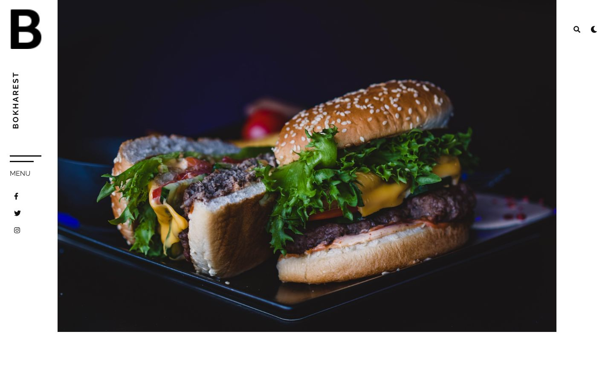
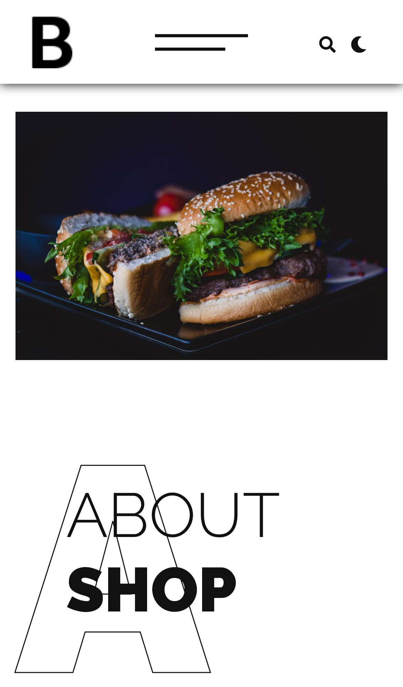
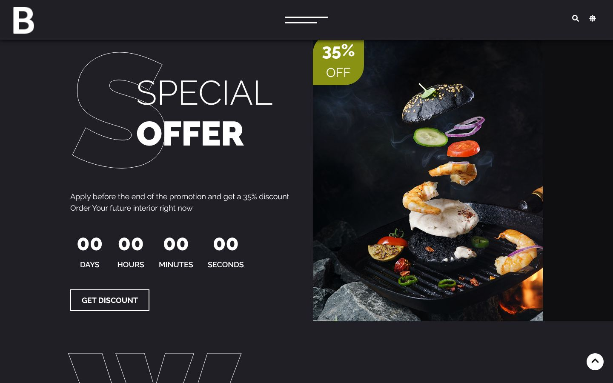
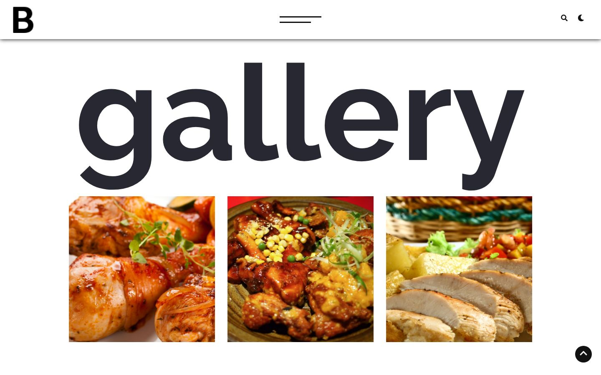

<div align="center">

# Bokharest

### Responsive restaurant landing page with dark mode · HTML · CSS · jQuery · Bootstrap 4

A one-page restaurant website with an auto-playing hero slider, an image gallery with a lightbox, a special-offer countdown, testimonials, a team section and a table-booking form. It has a light and a dark theme, and the choice is saved in the browser.

[](https://developer.mozilla.org/docs/Web/HTML)
[](https://developer.mozilla.org/docs/Web/CSS)
[](https://developer.mozilla.org/docs/Web/JavaScript)
[](https://jquery.com)
[](https://getbootstrap.com)
[](https://owlcarousel2.github.io/OwlCarousel2/)
[](https://fontawesome.com)
<br>
[](https://eslamraafat1.github.io/Bokharest/)

**[Live demo](https://eslamraafat1.github.io/Bokharest/)** ·
**[Portfolio](https://new-portfolio-ashy-xi.vercel.app/)** ·
**[LinkedIn](https://www.linkedin.com/in/eslamraafat-dev/)** ·
**[Email](mailto:eslamraafat736@gmail.com)**

<br>



</div>

<table>
  <tr>
    <td width="33%"></td>
    <td width="67%">
      <br><br>
      
    </td>
  </tr>
  <tr>
    <td align="center"><sub>Mobile (iPhone 13)</sub></td>
    <td align="center"><sub>Special offer (dark theme) · Gallery</sub></td>
  </tr>
</table>

---

## Contents

- [Overview](#overview)
- [Features](#features)
- [Tech stack](#tech-stack)
- [Page sections](#page-sections)
- [Project structure](#project-structure)
- [Getting started](#getting-started)
- [Deployment](#deployment)
- [Author](#author)

## Overview

**Bokharest** is a front-end practice project (2023): a landing page for a fictional restaurant. The brand, contact details and texts are placeholders (the About paragraph is dummy text), so the focus is on layout, responsiveness and interactions rather than real content.

What I practised:

- An editorial layout with a fixed vertical sidebar on desktop that turns into a top bar on smaller screens (`css/responsive.css`).
- A full light / dark theme built as a separate stylesheet, with the choice stored in `localStorage`.
- Wiring several jQuery plugins together: Owl Carousel, a countdown, Lightbox and AOS scroll animations.

## Features

### Layout and navigation

- **Fixed left sidebar** with the logo, a vertical brand name, a "Menu" button and social links. After scrolling, a fixed top bar fades in.
- **Slide-in side menu** with smooth scrolling to each section and an active-link highlight.
- **Full-screen search overlay** opened from the search icon.
- **Back-to-top button** that appears after scrolling down, and a loading screen that fades out when the page has loaded.
- **Responsive** down to phone widths (`css/responsive.css`, Bootstrap 4 grid).

### Content sections

- **Hero slider:** three food photos in an auto-playing Owl Carousel with a fade transition.
- **About:** large outlined title letters and **animated counters** (years of experience, dishes, staff, happy customers) that count up when the section scrolls into view.
- **Gallery:** six dish photos that open in a **Lightbox** gallery.
- **Special offer:** 35% discount card with a **countdown timer** (days, hours, minutes, seconds) using the jQuery Countdown plugin.
- **Testimonials** and **Team** cards.
- **Newsletter** field and a **Book a Table** form (name, email, phone, number of people, message). Both are front-end only.

### Theme and extras

- **Light / dark mode** toggled with the moon / sun icon. The theme is saved in `localStorage` (`restaurant-theme`) and restored on the next visit.
- **AOS scroll animations** on text and cards.
- **Schema.org `Restaurant` structured data** (microdata) in a hidden block, as an SEO exercise. It still holds the sample values from the schema.org example.

## Tech stack

| Layer | Tools |
| --- | --- |
| Markup and styles | HTML5, CSS3 (`index.css`, `ligthMode.css` theme file, `responsive.css`) |
| Framework | Bootstrap 4.5.2 |
| Scripting | JavaScript + jQuery 3.5.1 (`js/index.js`) |
| Plugins | Owl Carousel 2.3.4, jQuery Countdown, Lightbox, AOS |
| Icons and fonts | Font Awesome 5.15.1, Google Fonts (Raleway, Zen Tokyo Zoo) |
| Hosting | GitHub Pages |

## Page sections

| Anchor | Section |
| --- | --- |
| (top) | Hero slider |
| `#about` | About + animated counters |
| `#gallary` | Gallery with lightbox |
| `#offer` | Special offer + countdown |
| `#Testimonials` | Testimonials |
| `#Team` | Team |
| `#contact` | Newsletter, Book a Table form and footer contacts |

## Project structure

```text
.
├── index.html               # the whole one-page site
├── css/
│   ├── index.css            # main styles
│   ├── ligthMode.css        # light / dark theme rules
│   ├── responsive.css       # media queries
│   ├── lightbox.min.css
│   └── all.min.css          # Font Awesome
├── js/
│   ├── index.js             # slider, side menu, search, scroll effects, counters, countdown, theme toggle
│   └── lightbox-plus-jquery.min.js
├── assist/                  # local copies of jQuery, Bootstrap, Owl Carousel, countdown, AOS
├── images/                  # logo, slider, gallery, offer, staff and testimonial photos
├── screen/                  # older full-page screenshots (light and dark)
└── docs/screenshots/        # README images
```

## Getting started

No build step and no dependencies to install:

```bash
git clone https://github.com/Eslamraafat1/Bokharest.git
cd Bokharest
npx serve .        # or simply open index.html in a browser
```

The offer countdown targets a fixed date (`2023/03/28` in `js/index.js`); change it to see the timer run.

## Deployment

Deployed with **GitHub Pages** from the `master` branch: [eslamraafat1.github.io/Bokharest](https://eslamraafat1.github.io/Bokharest/).

## Author

**Eslam Raafat** — Front-End Developer (React · Next.js · TypeScript)

- **Portfolio:** [new-portfolio-ashy-xi.vercel.app](https://new-portfolio-ashy-xi.vercel.app/)
- **LinkedIn:** [linkedin.com/in/eslamraafat-dev](https://www.linkedin.com/in/eslamraafat-dev/)
- **GitHub:** [@Eslamraafat1](https://github.com/Eslamraafat1)
- **Email:** [eslamraafat736@gmail.com](mailto:eslamraafat736@gmail.com)
